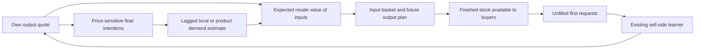

# Buying-behavior research report

**Final decision (2026-10-12): reject historical R1 and retain the production
baseline while its documented defects are addressed separately.** Research is
complete: 82 economic runs, an exact two-generation measurement replay and ten
isolated timing profiles support this decision. R1 fails the industrial fallback
contract, long-run trade, fairness and relative performance gates. Its market
information variant retains only **12.21% of baseline retail trade in the final
year of two generations**. No tested replacement is ready for adoption.

Production code, active defaults and the preserved zero-rent experiment remain
unchanged. Market requests are the preferred **next-study comparator** because
they perform best among the original R1 signals on the three held-out short-run
seeds; hybrid performs better over the first full generation. Neither result
establishes a generally superior or production-ready information model.

The scope authority is the
[research brief](buying-behavior-research-brief.md); numerical gates and the
experiment design were recorded in the [protocol](buying-behavior-research-protocol.md).
The [requirement-by-requirement audit](buying-behavior-requirements-audit.md)
records completion and distinguishes it from passing adoption gates.

**User-confirmed fallback rule (2026-10-11):** at each supplier, recompute total
demand at its price, subtract everything already bought, and cap the remainder
by available stock. Thus demand 10 at A with stock 2, followed by demand 8 at B,
means A sells 2 and B sells 6. This takes precedence over a research hypothesis.
The existing production reference and compiled retail paths both pass that exact
example, including stock, money, sales and COGS postings. An isolated reference
and 500 independent exhaustive-oracle comparisons verify the same fee-free
quantity rule; [tests](../tests/py/test_buying_fallback.py) and
[test log](../stats/buying-behavior-research/user-fallback-tests.log) contain the
evidence. Preference qualification after a split fill remains a separate pending
clarification; R1's historical canonical-bid policy is not implied by this rule.

Demand-loss denominators also differ between implementations. In a verified
baseline case with quote demands `[10,8,5]` and stocks `[2,3,20]`, the buyer
correctly takes `[2,3,0]`. The third quote requires no further purchase. The
baseline nevertheless retains the previous positive-request total of 8 in
`distributorLastQ` and reports 3 stock-unmet units. R1 instead records its first
funded quote-stage intention. These counters answer different protocol questions;
they are not interchangeable measurements of latent unmet demand. Actual goods
transactions, realized prices and posted earnings remain comparable. Any final
production metric must explicitly choose its reference quote and whether it
measures initial intentions, attempted remaining requests or terminal demand.
The [executable audit](../tools/buying_research/fallback_ledger_audit.py) and
[two-engine result](../stats/buying-behavior-research/fallback-demand-ledger-audit.json)
preserve this boundary; no historical recording was rewritten.

The industrial candidate has a more fundamental mismatch with the confirmed
rule: its one-supplier-per-ingredient restriction cannot take A's partial stock
and continue at B. In a one-input derived-demand example with quantities 10
and 8, A has two units. The confirmed `[2,6]` basket costs $68.63, versus
$71.89 for R1's `[0,8]`, with the same eight outputs. The
[independent split enumeration](../tools/buying_research/industrial_fallback_case.py)
and [result](../stats/buying-behavior-research/industrial-fallback-scope-counterexample.json)
make this a failed requirement for R1. Passing its restricted-action oracle
does not cure the mismatch. A full industrial replacement would need coupled
split purchases, lot rounding and shared-cash feasibility; the small example
does not validate that larger algorithm.

## Executive evidence

The actual baseline reproduces the motivating upstream/downstream difference.
Over its first complete 7,200-tick generation, refineries earn about 46% net
margin at 50% utilization, while manufacturers earn about 25% at 90% utilization.
In the next generation, these become about 55%/41% and 24%/76%, respectively.
These are period ratios of summed posted accounts; they do not establish a
profit optimum or identify a single cause. Manufacturer final sales fall between
generations while finished inventory remains substantial.


The dotted line marks the generation boundary at 7,200 ticks. Curves aggregate
30 completed ticks; margins and realized prices use summed accounts and sold
quantities. The [figure data](../stats/buying-behavior-research/figures-baseline/figure-data.json)
and [SVG](../stats/buying-behavior-research/figures-baseline/economy.svg) are retained.

The independent replay audit covers the preserved intervals 1–1,145 and
1,146–7,200 without gaps or overlap. Revenue, COGS, quantities, fee income/expense,
rent and reconstructed product net earnings match the new baseline exactly for
885,600 product/tick records. The audit found and corrected a **research recorder**
error in allocating T0 profit by product; original raw files are retained. Tier
totals and company earnings were unaffected. See the
[audit result](../stats/buying-behavior-research/legacy-baseline-verification-corrected-net.json)
and [code review](buying-behavior-code-review.md).

The two-generation baseline's balance changes also distinguish cash from
earnings. Over ticks 1–14,400, the following amounts are **billions of dollars**;
earnings come from posted income and expenses, independently of equity.

| Tier | Cash increase | Book-equity increase | Posted net earnings |
| --- | ---: | ---: | ---: |
| T0 | 47.0432 | 47.7942 | 47.7942 |
| T1 | 125.8337 | 125.9103 | 125.9103 |
| T2 | 83.8929 | 87.7379 | 87.7379 |

The old baseline recorder lacks opening company arrays, so this historical
comparison uses its saved tick-zero tier snapshot and final company accounts.
The unrounded equity-minus-posted-earnings residuals are $0.00, −$0.31905 and
$0.00092 across the full interval; they are reported, not plugged with balancing
entries. Per-tick reconciliation and its preregistered tolerance are separate
checks. Inventory investment explains why cash change need not equal earnings;
inventory acquisition itself creates no profit. See the
[balance and fee diagnostics](../stats/buying-behavior-research/baseline-two-generation-diagnostics.json).

An isolated candidate, R1, implements exact price-sensitive baskets over five
distinct alternatives plus an incumbent, with explicit partial-fill, fee and
preference rules. Its restricted solver passes independent exhaustive cases,
reference settlement, accounting and checkpoint checks. Two successive
optimizations preserve all 168 world arrays, checkpoint JSON and demand forecasts
exactly through a full-population 360-tick comparison. This verifies implementation
properties, not the expected-return model or production suitability.

The first 360 ticks at calibration seed 137 produce the following **startup**
comparison; all have the same initial state, production gate, price learner,
loyalty formula and adaptive schedule. The three R1 rows differ only in their
industrial information signal. The baseline differs in the whole procurement
protocol and must not be treated as a single-factor information ablation.

| Procurement | Retail units/tick | T1 net margin | T2 net margin | T2 utilization |
| --- | ---: | ---: | ---: | ---: |
| Existing baseline | 1,390,767 | 21.70% | 27.46% | 87.35% |
| R1 local first requests | 776,441 | 29.71% | 20.60% | 48.04% |
| R1 market requests | 1,128,651 | 31.32% | 21.03% | 69.68% |
| R1 half-local, half-market | 947,699 | 30.35% | 20.59% | 58.56% |

Market information leads these R1 startup results. That is not yet evidence of
better long-run recovery, acceptable performance or superiority to every possible
local estimator. A separate local alternative floors first requests by actual
sales, because a firm can receive fallback sales without the buyer's first request.
The campaign includes independent calibration and held-out seeds, complete
generations, multi-generation drift, single-factor ablations and stresses.

The second calibration seed, 271, distinguishes price/fee-sensitive intentions
from unfilled demand in ticks 721–1,080. All three R1 regimes face the same
2,099,424 latent retail units per tick. Local first-request learning submits
1,649,050 and sells 1,016,204; market learning submits 1,599,441 and sells
1,466,216; hybrid submits 1,625,377 and sells 1,366,924. Thus the aggregate local
shortfall is not explained by lower demand intentions. Its stock-constrained
loss is 632,846 units/tick versus 133,224 for market and 258,453 for hybrid.
These are recorded price/fee-sensitive intentions under the same R1 protocol,
not an inferred counterfactual willingness to buy at unchanged prices.

The same window has mean cross-product correlation of first differences in
finished stock of 0.151 for local, 0.00135 for market and 0.00148 for hybrid.
Unique-request first-difference correlations are near zero for all three.
This is evidence of synchronized inventory changes in this local treatment,
not proof that market information eliminates cycles in every condition. Fee
receipts are small in this window, and no company has positive net earnings
with negative merchandise gross profit. See the saved
[local](../stats/buying-behavior-research/diagnostics-local271-lastyear.json),
[market](../stats/buying-behavior-research/diagnostics-market271-lastyear.json)
and [hybrid](../stats/buying-behavior-research/diagnostics-hybrid271-lastyear.json)
diagnostics for definitions, distributions and company denominators.

Lower forecast error does not reverse that operational result. Against each
regime's own next-tick first-request observations, refinery mean absolute error
is 280 units/active line/tick for local, 1,189 for market and 917 for hybrid.
The observations themselves are affected by selection and the policy, so this
is not an external accuracy ranking of latent company demand. Market-wide equal
shares can be a less accurate predictor of who receives first requests while
supporting more actual transactions. Aggregate upstream/downstream squared-CV
ratios in this window are respectively 5.07/6.15 for local's T0/T1 requests,
0.095/0.091 for market, and 1.11/1.03 for hybrid. These descriptive ratios
normalize units but include endogenous trends and feedback; they are not a
causal estimate of the textbook bullwhip effect.

The alternative local estimator substantially changes that comparison. With
own observations `max(first requests, actual sales)`, third-year retail trade is
1,459,250 units/tick at seed 137 and 1,455,989 at seed 271. These are respectively
0.16% above and 0.70% below the matched market-information results. The analogous
hybrid estimator sells 1,437,677 and 1,428,213, and all four corrected runs have
no zero-sales manufacturer over that year. Thus the original local treatment's
large deficit is not evidence that companies intrinsically need global market
shares to replenish effectively. These are calibration observations and
motivated the explicitly amended longer tests; they are not held-out validation.
The [two-seed results](../stats/buying-behavior-research/sales-floor-two-seed-calibration.json)
retain margins, utilization, company earnings and exact windows.
The sales floor is still an explicit policy assumption: a buyer's first request
to one company and fallback purchase from another can inform both companies.
Summed company forecasts need not equal unique product demand, although the
recorded market-demand ledger is unchanged. Improved trade would not by itself
prove that these forecasts identify each company's latent demand.

## What the current system actually does

The frozen baseline is commit `f2b9b470fcf427a86915a721802f9505350e915d`, branch
`new-recipes`. At capture its tracked patch was empty; untracked research files
were included in its source archive and recorded status. Subsequent unrelated
naming work is preserved. Fresh configuration has
20 extractors, 1,008 refineries, 57,960 manufacturers, one million Distributors,
14 refined materials, 36 invented C3 and 69 invented C4 products. Activation is
0.105, latent order size is 20, and rent is zero. These values describe the
recorded configuration; they are not assumptions about other saved worlds.

| Actor | Baseline behavior | Research implication |
| --- | --- | --- |
| Gaia | Environmental difficulty and physical source | No invented procurement or supplier competition. |
| T0 | Extracts toward storage, subject to cost, cash, capacity and the existing margin gate | High inventory/spare capacity is possible. Some extraction quantities are fractional; manufacturing and purchases remain integral. |
| T1 | Fills raw-input storage deficits, searches the full T0 market, buys wholesale lots | The desired refill is independent of expected output sales and price. Buying and the later production margin gate are separate decisions. |
| T2 | Fills input allocations from full price-sorted books, then applies production constraints | Complementarity, cash and storage interact. C3 output can supply C4 in the same tick; final buyers see opening T2 stock. |
| T3 | Price-sensitive final demand, five draws with replacement, deduplication and fallback attempts | Five draws do not mean five distinct alternatives. Existing fallback and fee ranking are not an exact basket solution. |

The common selector favors a supplier that can fill the entire request over a
cheaper partial supplier. T1/T2 preference changes occur after any positive fill.
Both conflict with the brief's confirmed requirements. Incoming supplier demand
can include retries and is not a unique product-demand ledger. The sell-side
learner responds to unmet demand and a market-price anchor before its gross-profit
direction rule; the no-sales anchor can be an average of quotes. Flat prices or
falling demand therefore do not demonstrate maximum profit.

The annual fee adaptation is preserved, including the current T1 AOV denominator:
buying companies, rather than the number of ingredient transactions. Existing
prose describing successful purchase events is not a reason to silently change
the baseline during a procurement experiment.

Bots do not acquire extra machinery. Players can add eligible T1/T2 installations,
sharing storage and cash. Purchases exchange cash for equipment book assets and
record an external equipment sink; they are not immediate operating expenses.
The compiled R1 engine rejects multiple-route ownership explicitly. The small
general oracle demonstrates coupled shared-input optimization but is not a
scalable implementation of all player-controlled firms.

## Literature, identification and model choices

The [primary-source review](buying-behavior-source-review.md) records each source's
assumptions, mechanism, limitation and exact use. It distinguishes conceptual
validity, algorithm verification, implementation, economic behavior and practical
game suitability. Inventory theory supports modeling cash, fixed charges and
censored sales; it does not derive this game's horizon or demand calibration.
Search theory does not turn five free sampled offers into a globally optimal
search policy. Supply-chain amplification is a hypothesis to measure, not an
automatic explanation of this run.

One goods-price average, requested quantity and fulfillment ratio do not identify
an entire demand curve. For example, with elasticity two, the observation
`q(10)=5` fits `(L,Half)=(10,10)`, `(20,10/sqrt(3))` and
`(40,10/sqrt(7))`, among infinitely many alternatives. Fulfillment diagnoses
censoring; dividing a requested total that already includes unmet demand by
fulfillment again inflates it.

R1's industrial value is a game-specific expected-return assumption, not consumer
utility or a formula established by the literature. With finished stock F,
current own output quote P, horizon demand mean mu and conversion/overhead d:

`V(y) = P * mu * exp(-F/mu) * (1-exp(-y/mu)) - d*y`.

The proposed sale probability declines with additional inventory. The quote P
is a forecast assumption, not guaranteed revenue; it can be wrong after price or
demand shocks. Historical input basis is sunk in the procurement decision and
remains in actual inventory/COGS accounting. The [experimental contract](buying-behavior-model.md)
specifies all equations, units, constraints, numerical conventions and scheduling.

The preregistered default uses a three-tick planning horizon, an EMA with nominal
window 30 (`alpha=2/31`), a synthetic initial mean of half nominal capacity,
and a 0.5 hybrid weight. Local first-request, product-request equal-share and
hybrid forecasts use completed data with a one-tick publication lag. Shares are
estimates and never allocate customers. Equal and capacity-weighted shares are
identical within a product in the present single-line world because those lines
have the same nominal capacity; they differ for genuinely heterogeneous capacities.

Neither `L=2*capacity`, an automatic `2-fulfillment` multiplier, a 5% forced
margin, nor a minimum-of-cost-and-budget half-price is an approved economic law.
The campaign instead labels inventory, horizon, valuation and window changes as
explicit treatments. No customer demand or hidden transfer is introduced to
guarantee company profit.

The earlier candidate equations were dispositioned explicitly. An analytical
rejection means the equation was not promoted to a full-world treatment; it
does not mean a simulation of it failed.

| Earlier suggestion | Disposition and reason |
| --- | --- |
| `L=2*capacity` | Capacity is a hard feasible-output bound, not observed willingness to buy. The separate capacity-signal run tests the operational consequence of replacing demand information by nominal capacity; it does not identify the consumer curve's scale. |
| `L=2*allocated market demand` | It gives half of L at the chosen half-price by construction. It cannot determine that half-price or justify an industry's willingness to pay from one aggregate observation. R1 instead labels its product share as an uncertain output forecast. |
| Equal versus capacity-weighted shares | Identical for the current equal-capacity lines within a product. The heterogeneous-capacity analytic fixture demonstrates their difference; no duplicate full-world run is presented as independent evidence. Neither rule guarantees customers. |
| Half-price from an output-margin budget | An output quote and a desired margin can define an affordability policy, but cannot establish expected sales or the marginal value of complementary inventory. It remains an unadopted calibration, especially when output prices themselves adapt. |
| `min(average input cost, affordable input budget)` | Historical/average acquisition cost is not marginal willingness to pay, while a cash budget is a feasibility constraint. Taking their minimum conflates those roles and does not identify a demand curve. Rejected as a claimed derivation; not simulated as an optimum. |
| `2-fulfillment` multiplier | Would increase intentions that already include unmet demand without independent evidence for additional demand. The exact duplicate correction is unjustified here; fulfillment remains a censoring diagnostic. A different service-level policy would need its own objective. |
| Exponential inventory multiplier | R1 explicitly tests `exp(-F/mu)` as part of its assumed expected resale value. The model's truncation and omitted terminal value have analytic counterexamples; exponential form is not validated by convenience or concavity. |
| Thirty-tick window | A preregistered EMA decay assumption, compared with 5 and 90 in isolated ablations. Its mean information age is 14.5 ticks plus publication lag, not a literal 30-tick history cutoff. |
| Five-percent margin reference | Not adopted as guaranteed profit or a derived willingness-to-pay parameter. Existing loyalty calibration is retained separately. R1's own horizon calculation exposes a very different implicit service-level tradeoff, which is a limitation rather than a new target margin. |

The baseline is the clearly labeled storage-replenishment comparator. R1 is an
expected-return procurement experiment, and the sales-only, capacity-only,
quote-first and inventory-feedback treatments isolate particular assumptions
inside it. Their results cannot establish that every possible replenishment
or local-learning policy has been ruled out.

## Basket, fee and preference protocol

An order is one `(tick, company, input product)` boundary, or one Distributor's
assigned-product decision. Sample five distinct non-incumbents without replacement
plus a valid incumbent; include all if fewer exist, retain zero-stock offers as
observable, and order IDs deterministically. Read live stock after earlier buyers
have committed. Choose the company's whole basket before posting any debits.

The canonical bid is frozen before cash, fees and supplier-stock caps. Industry
uses its constrained physical planning problem at incumbent quotes, or sampled
median quotes when it has no incumbent. T3 uses its price-sensitive integer
demand at that canonical quote. Incumbent stock at this buyer's decision must
cover the **canonical** bid to make a fee payable. A positive outside purchase
then pays the incumbent one fixed fee; no purchase pays none. A partial outside
purchase can owe a fee while leaving preference unchanged.

Industry chooses one supplier per ingredient. Retail can split across sampled
sellers with one outside-purchase fee per order. A split retail order retains
preference. A single challenger establishes/replaces preference only if it alone
delivers at least the positive canonical bid. Numeric ties have declared
expenditure, incumbent-use and stable-ID rules; they are not random tie breaks.

The canonical convention prevents a buyer from freely submitting a fictitious
bid or repeatedly splitting one same-tick order to waive fees. It does **not**
make the protocol strategy-proof: a genuine valuation/quote change can raise the
canonical bid above incumbent stock and remove the fee, and an unaffordable bid
can do so too. These discontinuities are explicit tested properties.

There is also a consequential distinction between canonical and intended
quantity. With `L=20`, half-price $10, elasticity two and rounding draw 0.5,
an incumbent quote of $30 gives canonical bid two. An alternative at $1 would
receive a 20-unit intention but has only three units; the incumbent holds twenty
and the fixed fee is $2. R1 buys those three alternative units, pays the fee and
**changes preference**, because three covers the frozen canonical bid. It has
filled only 15% of the cheaper-quote intention. The
[executable fixture](../tools/buying_research/bid_semantics.py) and
[independent-oracle result](../stats/buying-behavior-research/canonical-versus-intended-bid.json)
make the distinction inspectable. If “whole relevant demand” means the whole
funded intention at the chosen quote, this candidate does not satisfy it.
Correctness under R1's explicit canonical convention is not approval of that
interpretation. This is another reason not to silently replace the live protocol.

For T3, marginal values invert the retained bounded quantity curve, using the
same rounding draw across all quotes. For each total quantity, compare incumbent
only with the minimum-cost allocation containing at least one outside unit.
Linear merchandise costs and a single fixed outside fee make these two cost
schedules exhaustive. Expensive fallback units must justify their own marginal
value or the basket's total gain after the fee.

For industry, minimal lot-rounded purchases cover an integer future output plan.
Existing ingredients, machinery footprint, input slots, total storage, stock,
shared cash and conversion reserve all constrain that plan. Unit-lot lower
envelopes split at owned-stock, supplier-stock and fee/price crossings. Inside an
interval, cost is affine and return concave, so clipped integer neighbors of
`y*=mu*log(P/(d+costSlope))-F` suffice. Wholesale lots instead partition constant
purchase vectors. Six-by-six supplier pairs alone do not solve quantities or
multiple routes. The independent oracle enumerates purchase vectors, suppliers
and feasible output plans in a different order.

The executable sequence is summarized below; the
[contract](buying-behavior-model.md) is the full equation and numerical-convention
specification, including integer rounding and all tie rules.

```text
At the start of a tick, freeze forecasts from completed observations.
Within each phase, for each buyer in the declared sequential order:
    sample distinct alternatives and include a valid incumbent;
    read the current offers, stock, cash, owned inputs and storage;
    solve the canonical no-fee/no-cash-limit/no-supplier-stock-limit bid;
    freeze each payable fee from incumbent stock versus that bid;
    solve one funded quote-stage intention with supplier stocks relaxed;
    solve the whole feasible basket against actual stock, including no purchase;
    commit goods, historical inventory basis, cash and separate fee transfers;
    qualify preference using the frozen bid and each actual supplier's delivery;
    record first intentions, retries and actual fills as distinct observations.
Run each phase's production and pricing before advancing as the schedule requires.
Run the preserved annual adaptation at its declared stage.
Publish completed observations for use on the following tick.
```

Industry's lot requirement is `x_m(y)=l_m*ceil(max(0,a_m*y-I_m)/l_m)`;
its objective is `V(y)-sum_m(p_m*x_m+fee_m)` with shared cash/conversion reserve
and physical constraints. For retail,
`v_k=Half*max(0,L/(k-1+max(u,1e-12))-1)^(1/eta)` for `k=1..ceil(L)`, and
`U(q)=sum_{k=1}^q v_k`. Maximize `U(sum_s x_s)-sum_s p_s*x_s-fee` over
integer stock-feasible allocations, including zero. Supplier enumeration draws
no new randomness; demand uses one fixed buyer/tick draw. The stable-ID sorted
book and explicit tie order make candidate evaluation count/order irrelevant
to the random sample and canonical quote convention. They do not remove the
separate seller-ID selection bias documented below.

## Worked examples and counterexamples

The [executable examples](../tools/buying_research/microcases.py) independently
check these against exhaustive enumeration and save their
[complete inputs and results](../stats/buying-behavior-research/worked-examples.json).
Values below are illustrative fixtures, not new production defaults.

- **T0:** no upstream buying problem exists. Extraction exchanges cash for
  inventory at its recorded extraction cost; sale posts revenue and removes
  that historical inventory basis as COGS.
- **T1 wholesale:** with 100 owned raw items, 1,000-item lots, `P=3`, `mu=6000`,
  `d=0.25`, and a $1.25 incumbent quote, the canonical bid is 4,000. An alternative
  at $1.10 makes a 5,000-item order optimal despite a $50 fee. Merchandise plus
  fee is $5,550, conversion reserve $1,275, planned output 5,100 and modeled
  incremental return $3,481.53. The actual quantity changes with the quote.
- **T2 complements and a partial challenger:** ten owned A items and no B;
  recipe A+B; A incumbent $1.50, challenger $1 with only two items; B $2;
  `P=8`, `mu=20`, `d=0.5`, cash $60. The canonical bids are A=4 and B=14.
  The optimal basket buys A=2 and B=12, pays the available A incumbent $0.20,
  reserves $6 conversion and retains the A preference. Its modeled return is
  $39.99. A costly full supplier is not automatically preferred.
- **T2 repeated ingredient:** with three owned C2 items and a recipe needing two
  C2 per output, cash $50 permits 19 new items at $2 and eleven planned outputs
  with $11 conversion reserved. The pre-cash canonical bid was 39 items. Recipe
  multiplicity, owned imbalance and cash are separate constraints.
- **T3 fallback:** marginal values `[12,8,4]`, one item at $1 and further items
  at $10 produce a one-item purchase. Carrying an old three-item request into
  the expensive fallback is inferior under the stated objective.

For the four required loyalty cases, use marginal values `[20,15]`, incumbent
price $11, alternative price $1, canonical bid two and fixed fee $2:

| Alternative stock | Incumbent stock | Actual allocation (incumbent, alternative) | Goods | Fee | Preference |
| ---: | ---: | --- | ---: | ---: | --- |
| 2 | 2 | (0, 2) | $2 | $2 | Alternative |
| 2 | 1 | (0, 2) | $2 | $0 | Alternative |
| 1 | 2 | (1, 1) | $12 | $2 | Incumbent |
| 1 | 1 | (1, 1) | $12 | $0 | Incumbent |

Correct single-order semantics do not rule out repeated fee collection. With
the retained quantity family (`L=20`, half-price 10, elasticity two), an incumbent
quote of $30 gives canonical quantity two. It holds two items. Two cheaper
sellers each offer one item at $1, and the fixed fee is $2. The optimal basket
buys one from each cheaper seller, pays the incumbent $2 and retains its
preference because neither challenger individually supplies two. Replenishing
the two cheaper offers repeats the outcome. Ten orders using seeded rounding
draws pay the incumbent **$20 while it sells zero goods and retains both items**.
The independent allocation oracle confirms each order; the
[counterexample](../stats/buying-behavior-research/fee-split-lock-in-counterexample.json)
and [executable fixture](../tools/buying_research/fee_lockin.py) are preserved.
Quotes and fees are held fixed for this fixture. It demonstrates that the chosen
split protocol cannot guarantee freedom from lock-in or fee farming; it does
not estimate their prevalence in an adaptive world. A remedy would need an
explicitly reviewed change to split qualification, order boundaries, preferences
or fee eligibility. Small observed fee receipts cannot invalidate the example.

The complete-kit action space has a concrete limitation. If A costs $1 and is
available only today, B costs $1 and is available only tomorrow, and their output
sells for $10 tomorrow, exhaustive two-period planning buys unmatched A now and
earns $8. A policy that refuses an incomplete current basket earns zero. R1
permits future complete kits and wholesale residue but excludes that unmatched
buffer. This is a model restriction, not a solver bug.

The objective also omits a constraint imposed by the retained production gate.
A manufacturer owns one A item with $100 historical basis; it needs one B at $1
and $0.75 conversion to sell one output at its current $10 quote. With horizon
mean 30, R1 values the missing-complement purchase at **$8.085 modeled incremental
return** and buys B. The existing compiled gate sees a $101.75 accounting unit
cost and permits **zero** output. The independent basket oracle agrees with
R1, and the actual compiled production-gate function confirms zero. Thus both
pieces can be implemented correctly while their combined plan is incoherent
at fixed quotes. The acquired B remains an inventory asset; neither an $8 profit
nor a $1 operating expense arises merely from buying it. See the
[gate counterexample](../stats/buying-behavior-research/production-gate-counterexample.json)
and [executable audit](../tools/buying_research/gate_audit.py).
Ignoring sunk basis in an incremental objective is not itself the error; failing
to respect an independently retained execution constraint is. A replacement
must incorporate the gate or propose its alteration as a separate behavior
decision. This case does not measure how often the mismatch occurs in the
adaptive world or assume that future quotes stay fixed there.

A second limitation follows without simulation. In a homogeneous, unconstrained,
fee-free case with no existing stock, daily demand D and total marginal cost c,
the R1 optimum is `y=H*D*log(P/c)`. At a 25% markup and H=3, this is only
`0.66943*D`. The implied minimum margin for replacing D at H=3 is
`1-exp(-1/3)=28.35%`. This does not establish an equilibrium or guarantee profit;
it exposes a service-level consequence of truncating expected resale value at
the horizon with no terminal value. Nonperishable stock retains future options,
so the assumption needs validation. The H=1/H=6 experiments test this mechanism;
changing H to achieve an attractive margin would not validate the model.

The implementation permits the following feedback paths. Arrows describe code
dependencies, not estimated causal strengths; the controlled ablations test
parts of this system. A demand estimate alone does not specify a buyer's
willingness to pay when its own selling quote is endogenous.



For example, lowering inventories can create unfilled requests even when an
output quote is already high. The retained scarcity response can interpret
those requests as reason to raise the quote. That higher quote raises R1's
resale valuation, while eventual final-demand reduction lowers its quantity
forecast. Which path dominates is an empirical outcome; higher margins with
lower trade are not successful optimization by definition.

The exact general small oracle also demonstrates two routes sharing one input
and cash. Its route vector `(1,1)` uses three shared-input units; independent
two-unit route plans would exceed availability. General multiple-route fixed-fee
selection contains a knapsack problem, so the single-route constant-small-offer
argument does not establish a scalable exact solution for every ownership state.

An equal-quote fixture also falsifies neutrality of R1's stable-ID tie rule.
With 100 equally eligible sellers, five distinct sampled alternatives, no
incumbent and ample stock, the lowest 20 seller IDs receive **68.07%** of first
requests; the highest 20 receive **0.0206%**. Exact order statistics give
`Pr(chosen ID=j)=C(99-j,4)/C(100,5)`. Three 100,000-buyer samples confirm the
pattern while individual offer inclusion stays near 5%. Uniform discovery is
therefore not uniform selection. Finite stocks and incumbency alter full-world
shares; this fixture does not attribute all of local learning's performance gap
to tie bias. It identifies a concrete vulnerability, particularly when fallback
sales do not enter the first-request forecast. The frozen experiment retains
this rule. A role-specific deterministic random tie priority is a candidate
repair requiring its own validation, not an adopted change. See the
[audit](../stats/buying-behavior-research/equal-quote-tie-audit.json).

## Campaign, results and adoption decision

All 82 economic runs, their final study/diagnostics, ten isolated timing profiles
and the final evidence audit are complete. The
[study](../stats/buying-behavior-research/final-study/study.json),
[comparisons](../stats/buying-behavior-research/final-comparisons.json) and
[93-run source/coverage audit](../stats/buying-behavior-research/final-evidence-audit.json)
identify every completed treatment and measurement window. The 93 artifacts
comprise 82 economic runs, one measurement replay and ten timing profiles; they
are not 93 independent economic replications.

The evidence already rules out adopting historical R1 as a production
replacement: its industrial supplier restriction fails the user's confirmed
fallback rule, and every tested whole-generation information variant loses most
baseline trade. Temporary-shock recovery passes its declared gate, but relative
performance fails in every matched profile. Neither accounting correctness nor
recovery erases the independent model failures. Retaining the baseline temporarily does not endorse its known
full-fill ranking, partial-preference or demand-counter defects.

The preregistered hypotheses require different conclusions:

| Hypothesis | Evidence-backed disposition |
| --- | --- |
| H1: storage-deficit replenishment sustains upstream demand beyond prospective returns | Not separately identified by the baseline/R1 comparison, which changes several purchasing rules together. The inventory-discount ablation and stocks/earnings accounts expose sensitivity, but do not prove this is the sole source of baseline upstream margins. |
| H2: fees, supplier/preference rules and pricing anchors each contribute | Supported conditionally by exact fee/ranking counterexamples and the separate fee/anchor world treatments. Direct fee transfers do not measure their full behavioral feedback. No anchor-only or fee-only explanation of generation-long contraction is established. |
| H3: sales censoring and access to wider information matter | Supported as a model concern by the sales-only collapse, local observation counterexamples and paired regime differences. No tested local, market or hybrid estimator establishes long-run suitability. |
| H4: fixed charges and complements require coupled feasible decisions | Supported within the declared action sets by exhaustive counterexamples and exact solver comparisons. The scalable R1 implementation still omits industrial splits, general multiple-route firms and useful unmatched buffers. |

Three held-out seeds reproduce the original information regimes' **short-run**
ranking in ticks 721–1,080. Each cell below is candidate retail units divided by
its paired baseline's units over that same window.

| Original R1 regime | Seed 811 | Seed 1597 | Seed 2027 | Seed mean | Seed-level standard error |
| --- | ---: | ---: | ---: | ---: | ---: |
| Local first requests | 63.21% | 64.11% | 64.40% | 63.90% | 0.36 percentage points |
| Market requests | 92.76% | 93.57% | 93.96% | 93.43% | 0.35 percentage points |
| Hybrid first requests | 86.82% | 86.02% | 85.09% | 85.98% | 0.50 percentage points |

All three original policies have lower T2 total net earnings than baseline in
each of these windows; market's shortfall is $3.20–3.35 million per tick, local's
$5.98–6.18 million and hybrid's $4.04–4.39 million. No route's negative-earner
share increases. These results support a reproducible short-run difference,
not a complete-generation rollout pass. There are three independent seed
pairs, not 1,080 independent observations. The small seed-level standard errors
do not account for structural model uncertainty or longer-run drift. All pairs,
route distributions and annual accounts are in the
[held-out study](../stats/buying-behavior-research/heldout-study/study.json).
The sales-floor extension has calibration evidence only; these held-out results
must not be presented as validation of that later amendment.

The original three R1 regimes have now completed a matched generation at seed
137 (ticks 1–7,200). All fail the intended trade-retention pattern despite
positive aggregate posted earnings. Their full-period retail volumes are only 39.7%,
50.8% and 54.2% of baseline for local, market and hybrid respectively; the final
year is worse. No product has literally zero trade over that final year, and no
company has negative annual earnings in these runs. Those two checks alone
would therefore conceal the contraction.

Company distributions expose the difference. In the final year, 28.26% of the
57,960 local-policy manufacturers make **no sales**, compared with none in
baseline or market and two companies in hybrid. Local's median company earns
only $6.42 per tick, while its 95th percentile earns $669.10. The aggregate
earnings figure therefore does not describe a typical firm.

| Final-year policy | Zero-sales companies | Earnings/company/tick, 5th percentile | Median | 95th percentile |
| --- | ---: | ---: | ---: | ---: |
| Baseline | 0.00% | $30.47 | $96.28 | $178.96 |
| Local first requests | 28.26% | $0.00 | $6.42 | $669.10 |
| Market requests | 0.00% | $86.34 | $120.33 | $208.42 |
| Hybrid first requests | 0.00345% | $69.80 | $148.66 | $318.84 |

These quantiles use each company's total posted earnings over 360 ticks, then
divide by 360. They are not quantiles of tick-level averages. Product-level
company distributions are also retained for single-product T1/T2 ownership;
T0 portfolio profit is not falsely attributed to individual raw products.
In the product files, T0's `companyDenominator` is the recorder's fractional
company-equivalent allocation across installed lines, not the number of unique
raw-product owners. Its per-company field uses that allocated denominator.
Actual T0 company distributions use all 20 portfolios. T1/T2 product counts
are actual company counts in these single-product worlds. Company-wide T0 fees
are allocated across lines for product net accounts; unrecorded product-specific
fee receipts are not inferred. The raw schema and final analyzer label these
distinctions explicitly.
An independent reconciliation of all 119 T1/T2 product groups reproduces the
recorded product sales, earnings and company counts in the local final year:
[distribution audit](../stats/buying-behavior-research/product-company-distribution-audit.json).

| Policy | Generation retail units/tick | Final-year retail units/tick | Generation T1 net margin | Generation T2 net margin | T2 output/capacity | T2 net earnings/company/tick |
| --- | ---: | ---: | ---: | ---: | ---: | ---: |
| Baseline | 1,423,190 | 1,257,305 | 46.26% | 24.96% | 90.09% | $102.90 |
| Local first requests | 564,585 | 101,940 | 75.98% | 32.50% | 34.91% | $98.04 |
| Market requests | 722,998 | 192,000 | 71.68% | 36.44% | 44.83% | $130.97 |
| Hybrid first requests | 771,200 | 249,778 | 72.80% | 37.70% | 47.79% | $139.07 |

The final-year window is 6,841–7,200; other columns cover the whole generation.
The earnings denominator is 57,960 manufacturing companies. Output includes
intermediate production, whereas retail units count only final sales.
[Tier and route tables](../stats/buying-behavior-research/generation-one-comparisons/tier-route-tables.md)
show T0, C1, C2, C3, C4 basic-plus-C3 and C4 compound-plus-compound separately,
with sales and total/per-company earnings together. The company denominators
are respectively 20, 288, 720, 38,088, 4,032 and 15,840. Raw, refined and
manufactured units are different goods, not additive final-consumption counts.
[Full accounts and distributions](../stats/buying-behavior-research/generation-one-comparisons/summary-four-regimes.json)
and the individual analysis files retain tier/product/route detail. These are
one seed's full-generation observations, not three held-out full-generation
replicates or proof of permanent collapse. The completed second market
generation and extended sales-floor variants are separate tests below.


Each plotted observation sums 30 ticks. The
[figure data](../stats/buying-behavior-research/figures-generation-one/figure-data.json)
retain both total profits and units. Higher margins and nominal company profits
in some candidates coexist with far less physical trade and idle machinery.

The market candidate and baseline have both completed **14,400 ticks**, including
40 annual loyalty recalibrations. The second generation confirms that R1's
contraction is not merely a short startup dip:

| Policy and window | Retail units/tick | T2 total earnings/tick | T2 net margin | T2 utilization |
| --- | ---: | ---: | ---: | ---: |
| Baseline, generation 2 (7,201–14,400) | 1,210,333 | $6.222m | 23.68% | 76.43% |
| Market, generation 2 (7,201–14,400) | 152,434 | $7.973m | 57.03% | 9.28% |
| Baseline, final year (14,041–14,400) | 1,190,612 | $6.432m | 24.40% | 75.03% |
| Market, final year (14,041–14,400) | 145,349 | $8.038m | 58.84% | 8.84% |

The final market year retains only **12.21%** of baseline retail trade. T1 net
margin is 88.36%, versus baseline's 54.76%. Market T2 realized price is $91.09
per sold item and realized COGS is $37.56, versus baseline's $20.71 and $15.66.
Relative to initial quotes weighted by the current sales mix, those T2 prices
are 11.19 and 2.53 times the reference. This is not a fixed-basket price index.
The market's final-year manufacturer median earnings are $135.82 per tick
(5th/95th percentiles $69.53/$219.66), versus baseline's $111.14
($31.07/$203.96). Twenty-eight market manufacturers make no sales during that
year; none do in baseline. Every product still trades and no company has
negative annual earnings. These distributional checks do not overturn the
physical-trade failure.

Market prices and units become nearly flat at this low activity level. Between
the last two years, T2 realized price changes by −0.0042%, retail units by
−0.0348%, and total T2 net earnings by −0.1395%. A flat series alone therefore
cannot establish a suitable economy. Finished-stock coverage is 2.64 ticks in
market versus 85.72 in baseline, so the candidates' problem is not simply the
baseline's large manufactured-goods stock. Upstream market raw-goods coverage
is instead 1,638 ticks, versus 192 in baseline; the different tiers must be
examined separately. All figures are observed outcomes of seed 137, not proof
of a permanent equilibrium or the globally optimal prices.


The [second-generation and final-year accounts](../stats/buying-behavior-research/two-generation-study/generation-comparison.json),
[explicit tier/route tables](../stats/buying-behavior-research/two-generation-study/tier-route-tables.md),
[annual accounts](../stats/buying-behavior-research/two-generation-study/annual-groups.csv)
and [plotted 30-tick sums](../stats/buying-behavior-research/figures-two-generations/figure-data.json)
preserve the denominators, products and distributions. The figure was visually
checked. Saved tick-14,400 quote/cost snapshots for
[baseline](../stats/buying-behavior-research/baseline-cost-snapshot-14400.json) and
[market](../stats/buying-behavior-research/market-cost-snapshot-14400.json) separately
verify the recipe bills described below. Full-run sampled decision replay passes
960 T1, 28,320 T2 and 5,046 T3 decisions, including fees and preferences.

The sales-floor variants have also completed a full generation. They test a
broader local signal, `max(first requests, actual sales)`, while keeping the
other R1 settings. Both still lose most baseline retail trade by the final year:

| Sales-floor regime | Generation retail units/tick | Generation T2 total earnings/tick | Final-year retail units/tick | Final-year share of baseline retail | Final-year T2 total earnings/tick |
| --- | ---: | ---: | ---: | ---: | ---: |
| Local | 682,353 | $5.027m | 110,036 | 8.75% | $4.650m |
| Hybrid | 769,385 | $7.699m | 228,056 | 18.14% | $9.141m |

The local sales floor reduces the final-year zero-sales share from the original
local policy's 28.26% to **11.27%** (6,531 companies), and raises median company
earnings from $6.42 to $28.42 per tick. Its 5th/95th percentiles are $0/$383.07.
The hybrid floor has five zero-sales companies (0.00863%), median earnings
$140.89 and 5th/95th percentiles $64.92/$315.10. No company has negative earnings
over that final year. Nonetheless T2 utilization is only 6.80% in local and
14.00% in hybrid; T1 net margins reach 93.66% and 86.79%. Correcting the local
observation improves some distributional outcomes but is insufficient to
prevent this candidate's contraction. Hybrid's floor variant does not improve
the original hybrid's full-generation retail volume (769,385 versus 771,200).


The [whole-generation and final-year accounts](../stats/buying-behavior-research/sales-floor-generation-comparison/summary.json)
include total sales, profits, prices, inventories and company distributions;
the individual files retain every tier/route/product. The explicit
[tier/route tables](../stats/buying-behavior-research/sales-floor-generation-comparison/tier-route-tables.md)
show extraction, C1, C2, C3 and both C4 routes with company denominators, total
units and total/per-company earnings. The
[plotted data](../stats/buying-behavior-research/figures-sales-floor-generation/figure-data.json)
use 30-tick sums and were visually checked for readable labels and complete
four-series coverage. These are seed-137 calibration results. They do not supply
held-out full-generation validation or proof of every future trajectory.

The cost comparison uses explicit definitions. `t1UnitCost`/`t2UnitCost` is
the last successful production batch's cost, or its synthetic initialized cost
before any production. It can be stale when a line is idle. Realized COGS is the
historical basis of the items actually sold. A third comparator, calculated from
the saved checkpoint, is the recipe's input bill at **current mean posted input
quotes plus conversion**. It ignores stock, sampling, fees, rent and owned
inventory, so it is not an executable purchase-cost forecast. These three costs
must not be interchanged.

At tick 7,200 the line-weighted means are:

| Policy | T0 quote | T1 quote | T1 current-quote input bill | T2 quote | T2 current-quote input bill | T2 last-batch cost |
| --- | ---: | ---: | ---: | ---: | ---: | ---: |
| Baseline | $1.876 | $7.339 | $3.466 | $19.796 | $15.478 | $15.357 |
| Local | $1.025 | $31.606 | $2.007 | $120.833 | $71.720 | $70.075 |
| Market | $1.109 | $19.203 | $2.151 | $84.203 | $42.979 | $42.468 |
| Hybrid | $1.032 | $14.253 | $2.019 | $71.183 | $32.519 | $31.911 |
| Local sales floor | $1.043 | $32.074 | $2.037 | $114.835 | $71.875 | $70.905 |
| Hybrid sales floor | $1.058 | $15.150 | $2.064 | $75.100 | $34.763 | $34.073 |

These are dollars per output item at the saved tick, averaged across active
production lines; they are not period-sales-weighted realized prices. T0's
recorded extraction cost is $1.003 in all six states. Common initial mean quotes
were $1.250, $2.994 and $8.242 for T0/T1/T2; initial recorded costs were $1.000,
$2.393 and $6.592. High refinery quotes therefore coexist with lower raw-input
bills in the candidates, while manufacturers face much higher intermediate
input bills. The observation does not identify every causal path in that
feedback system.

The preserved baseline has 23 per-tick product fields and lacks the later
`recordedUnitCostSum` history. That missing history stays unavailable. These
snapshot costs come from its actual checkpoint rather than invented historical
detail. [All product/route snapshots](../stats/buying-behavior-research/cost-snapshots-7200/summary.json)
and [independent catalog-ID bill validation](../stats/buying-behavior-research/cost-snapshots-7200/independent-bill-verification.json)
are retained; 119 products in each of six states, including 14 repeated-input
recipes per state, agree exactly. The
[extractor](../tools/buying_research/cost_snapshots.py) records checkpoint hashes
and does not mutate the world.

Annual loyalty recalibration remains active throughout these runs. At tick
7,200, the T1 fee multiplier is 405.37 in baseline, 105.93 in local, 79.07 in
market and 101.54 in hybrid, versus the common initial 33.33. The corresponding
T3 multipliers are 1.2101, 0.7282, 0.7435 and 0.8256, versus initial 0.1541.
These are dimensionless multipliers in the retained fee formula, not dollar
fees. The actual fee additionally depends on its reference unit cost and
incumbent reliability. The
[annual multiplier and order-value trajectories](../stats/buying-behavior-research/generation-one-loyalty-trajectories.json)
retain every year end and the ranges, including separate C3/C4 T2 values.
Thus a multi-generation experiment does not hold switching friction constant
merely because its initial configuration is unchanged.

The completed seed-137 pricing ablations already reject an anchor-only
explanation of R1's third-year refinery margin. With all market-price anchors
disabled, R1 market information sells 1,455,810 retail units/tick and T1 net
margin is 46.71%, versus 1,456,904 and 46.78% with the existing anchors. Other
pricing rules remain active. The same intervention in baseline leaves retail
trade almost unchanged (1,570,434 versus 1,570,762) while lowering the realized
T1 price from $3.388 to $3.056 and increasing T2 net margin from 43.03% to
46.75%. This establishes a conditional short-run contribution to baseline
input costs, not a full-generation repair or a profit-optimum result. Upstream-only
and T2-only treatments distinguish interactions; their
[completed comparisons](../stats/buying-behavior-research/anchor-three-year-comparison.json)
and [matched controls](../stats/buying-behavior-research/interim-upstream-anchor/summary.json)
retain the exact windows and quantities.

Switching fees have a separate, measurable effect in the completed no-fees
ablation. At seed 137 in ticks 721–1,080, retail trade rises from 1,456,904 to
1,530,210 units/tick (+5.03%); T1 net margin falls from 46.78% to 40.68%, while
T2 net margin rises from 29.97% to 43.30% and T2 total earnings rise from
$6.071 million to $9.178 million per tick (+51.17%). All posted switching
income and expense is zero in this treatment. This identified intervention
shows that selection and price-feedback consequences can greatly exceed the
direct fee transfer. It neither isolates every downstream path nor proves that
fees explain the full-generation contraction. The unchanged fee formula remains
part of the main candidate; removing it is an ablation, not an adopted fix.
See the [control](../stats/buying-behavior-research/interim-ablations/20261011-control-market-137.json)
and [no-fees accounts](../stats/buying-behavior-research/interim-ablations/20261011-ablation-no-fees-137.json).

Suppressing only the finished-stock discount in R1's purchase valuation gives
another distinct short-run response: 1,560,802 retail units/tick (+7.13%),
97.77% T2 utilization and $6.715 million T2 net earnings per tick in the same
third-year window. Mean finished coverage rises from 1.03 to 2.70 ticks, while
T1 net margin falls to 43.88%. Physical storage and owned-input constraints still
apply. This identifies sensitivity to the valuation's inventory term; it does
not validate ignoring stock or show that its accumulation remains acceptable
over a generation. The complete-kit/gate and ownership limitations remain.
The [recorded accounts](../stats/buying-behavior-research/interim-ablations/20261011-ablation-no-inventory-feedback-137.json)
preserve both the trade increase and the larger stock buffer.

The preregistered horizon comparison corroborates the analytical service-level
concern. With all other R1 market settings retained, final-year outcomes are:

| Planning horizon | Retail units/tick | T2 utilization | T2 net margin | T2 net earnings/tick | Mean T2 input storage space | Finished coverage |
| --- | ---: | ---: | ---: | ---: | ---: | ---: |
| 1 tick | 332,861 | 20.15% | 21.93% | $0.955m | 0 | 0.98 ticks |
| 3 ticks | 1,456,904 | 90.07% | 29.97% | $6.071m | 495,343 | 1.03 ticks |
| 6 ticks | 1,562,099 | 97.83% | 38.09% | $8.420m | 9,100,627 | 1.30 ticks |

Input storage space is the sum over 57,960 manufacturers, measured after each
tick; it is not dollars or a count of interchangeable ingredients. A zero closing
input balance can coexist with same-tick input purchases and consumption.
The horizon changes both the demand scale and the permitted production plan.
Six ticks substantially improves this three-year treatment, but does not settle
long-run feedback, complementary buffer value, the production-gate mismatch or
the now-confirmed requirement for industrial split purchases. It is not adopted
by fitting a desired margin. Complete records are in the
[one-tick result](../stats/buying-behavior-research/interim-ablations/20261011-ablation-horizon-one-137.json)
and [six-tick result](../stats/buying-behavior-research/interim-ablations/20261011-ablation-horizon-six-137.json).

Discovery scope is also consequential without a monotone aggregate response.
One, five and twenty sampled alternatives yield 1,245,807, 1,456,904 and
1,392,501 retail units/tick respectively in this same seed/window. T2 total
earnings are $4.917m, $6.071m and $4.842m per tick. Changing sample count changes
the actual samples, purchases and subsequent economic history. These results
therefore do not test nested feasible sets at fixed quotes and valuations.
Five alternatives remains the user-specified production scope; twenty is a
research comparison, not an adopted exhaustive-search substitute. The
[one-offer result](../stats/buying-behavior-research/interim-ablations/20261011-ablation-one-alternative-137.json)
and [twenty-offer result](../stats/buying-behavior-research/interim-ablations/20261011-ablation-twenty-alternatives-137.json)
retain stock, earnings and product distributions.

All 16 one-factor or explicitly bundled diagnostic ablations are complete at
seed 137. The common reporting window is ticks 721–1,080; amounts below are
total T2 net earnings per tick, not profit per unit:

| R1 market control or identified change | Retail units/tick | T1 net margin | T2 net margin | T2 net earnings/tick |
| --- | ---: | ---: | ---: | ---: |
| Control | 1,456,904 | 46.78% | 29.97% | $6.071m |
| No switching fees | 1,530,210 | 40.68% | 43.30% | $9.178m |
| No finished-inventory valuation discount | 1,560,802 | 43.88% | 31.26% | $6.715m |
| Select one supplier by quote before quantity | 976,982 | 51.21% | 23.31% | $3.176m |
| No T2 market-price anchor | 1,451,810 | 46.59% | 29.99% | $6.055m |
| One alternative | 1,245,807 | 44.57% | 27.87% | $4.917m |
| Twenty alternatives | 1,392,501 | 46.03% | 26.52% | $4.842m |
| Horizon 1 | 332,861 | 52.75% | 21.93% | $0.955m |
| Horizon 6 | 1,562,099 | 39.95% | 38.09% | $8.420m |
| Information window 5 | 1,465,257 | 46.47% | 30.65% | $6.252m |
| Information window 90 | 1,445,426 | 46.69% | 29.55% | $5.930m |
| Industrial resale-value multiplier 0.8 | 136,529 | 58.26% | 23.34% | $0.446m |
| Industrial resale-value multiplier 1.2 | 1,547,287 | 43.28% | 35.26% | $7.747m |
| Zero synthetic cold-start prior | 1,445,428 | 46.68% | 29.90% | $6.031m |
| Reverse industry and retail priorities | 1,473,200 | 45.43% | 30.32% | $6.205m |
| Own sales as demand signal | 11,206 | 48.46% | 24.45% | $0.033m |
| Capacity as demand signal | 1,117,043 | 46.97% | 37.59% | $5.798m |

The [machine-readable comparison](../stats/buying-behavior-research/interim-ablations/summary-all16.json)
links each row to its exact options and full product/company analysis. The
quote-first treatment selects one supplier per input by quote plus fee divided
by canonical bid before checking actual stock; it then retains joint quantity
optimization over that restricted selection, without fallback. It is not an
ablation of every form of complementary optimization. The valuation multiplier
changes industrial expected resale value only, not Distributor demand curves.
The sales-only signal's severe contraction supplies a direct censored-sales
failure case. A capacity signal remains a labeled proxy, not observed demand.
Changing the synthetic prior has little third-year effect here, while modest
resale-value changes have much larger consequences. These experiments establish
conditional sensitivity, not universal parameter optima. They do not authorize
retuning the candidate to a desired profit or adopting an untested combination.

Reversing industry and retail buyer priority crosses the preregistered fairness
flags. In ticks 721–1,080 at seed 137, retail units rise only 1.12%, but the mean
extractor's net earnings rise 13.66%, from $54,540 to $61,990 per tick. The
extractors' 5th-percentile earnings fall 27.17% and their 95th percentile rises
18.30%. Among C2 refineries, 5th-percentile earnings rise 40.28% and
95th-percentile earnings fall 13.85%; the 5th-percentile units-sold measure
rises 54.27%. Manufacturer mean earnings stay within 5% in every route, yet
5th-percentile earnings rise 12.99% in C3 and 11.68% in C4 compound pairs.
Aggregate output similarity therefore does not establish order neutrality.
These are relative changes in period company outcomes, not percentage-point
changes or independent tick samples. The experiment changes both purchasing
orders together; it does not identify their separate contributions or prove
the same advantage across every seed.

The [tier/route table](../stats/buying-behavior-research/interim-fairness/tier-route-table.md)
and [full comparison](../stats/buying-behavior-research/interim-fairness/comparison.json)
retain all means, tails and undefined values. A
[source/configuration check](../stats/buying-behavior-research/interim-fairness/source-comparison.json)
confirms identical execution code except the documented singular-rounding
repair, whose zero endpoint never occurs for seed 137 in this window. Together
with the exact stable-ID tie counterexample, the result prevents a general
fairness claim for R1. A new tie rule or priority policy would be a separate
identified treatment, not a silent repair to these results.

Expanded-catalog treatments use separately archived, dependency-closed source
copies. The first enables all 40 C3 recipes with the existing 69 C4 recipes
(109 products); the second enables all 40 C3 and 215 C4 recipes supported by
the present T2 adapter (255 products). “All” here does not mean every possible
higher-complexity recipe in the universe. Both retain 57,960 manufacturers and
one million Distributors, while the unchanged initializer reallocates firms,
equipment mix and demand routing across the enabled products. Thus expansion
is not a pure product-count intervention at unchanged industry weights. The
adapter revision, exact recipe selection and each run's `allocation.json` make
those changes inspectable. The production catalog and live allocation are
unchanged by these experiments.

Both expanded-catalog pairs completed 1,080 ticks at seed 137. In the final
360-tick window, all products traded in both policies:

| Enabled products | Policy | Retail units/tick | T1 net margin | T2 net margin | T2 total net earnings/tick |
| --- | --- | ---: | ---: | ---: | ---: |
| 109: 40 C3 + 69 C4 | Baseline | 1,558,601 | 29.07% | 43.56% | $9.754m |
| 109: 40 C3 + 69 C4 | R1 market | 1,456,124 | 48.72% | 30.54% | $6.262m |
| 255: 40 C3 + 215 C4 | Baseline | 1,579,685 | 35.84% | 37.27% | $8.233m |
| 255: 40 C3 + 215 C4 | R1 market | 1,478,097 | 43.87% | 30.35% | $6.152m |

The larger catalog assigns 48,868 companies and 865,240 Distributors to C3;
6,782 and 100,523 to C4 basic-plus-C3; and 2,310 and 34,237 to C4 compound pairs.
Its minimum is 42 manufacturers per enabled product. These are explicit new
allocations, not the current 105-product world's counts. The two scenarios show
that the short-run candidate/baseline gap persists under these fresh-world
expansions. One seed and three years do not establish long-run expanded-catalog
stability. Results and per-product/company distributions are retained for the
[109-product pair](../stats/buying-behavior-research/interim-expanded-c3/summary.json)
and [255-product pair](../stats/buying-behavior-research/interim-expanded-all/summary.json).

Completed transient comparisons already distinguish stock buffering from robust
recovery. Each percentage below is actual retail units divided by the **same
policy's** unshocked control in the same ticks at seed 137. The intervention
window is 181–360 and the final year is 721–1,080:

| Intervention | Baseline during intervention | Market during intervention | Baseline final year | Market final year |
| --- | ---: | ---: | ---: | ---: |
| Distributor activation ×2, then restored | 100.05% | 123.19% | 99.98% | 100.23% |
| Distributor activation ×0.1, then restored | 11.59% | 4.84% | 102.36% | 104.32% |
| All extraction stopped, existing stock tradable | 100.00% | 76.83% | 100.30% | 93.80% |
| Water supplier offers unavailable | 73.06% | 42.48% | 100.16% | 93.29% |
| One-time T1 quote ×2, subsequent learning retained | 43.73% | 0.54% | 99.32% | 1.46% |

Doubling activation does not double actual sales when supply binds. After the
demand collapse, baseline's first 180 restored ticks sell 117.45% of control
while market sells 78.53%; their later final-year overshoots are smaller.
Extraction cessation and unavailable Water offers are different experiments:
the former can draw down tradable inventories, while the latter prevents
transactions in Water for the declared interval. Restored temporary-shock
final-year ratios exceed 90% for both policies in these comparisons, but this
does not mean their transient losses were small or their absolute long-run
trade is healthy.

The quote shock is **not forcibly reversed at tick 361**. Existing price learning
continues after the one-time doubling. Market retail sales are exactly zero
through ticks 361–540 and recover only to 21,225 units/tick in the final year,
versus its ordinary control's 1,456,904. Baseline reaches 1,560,075 versus its
control's 1,570,762. This is a serious adverse-price failure of this candidate,
not evidence that the production gate or demand curve should be silently
retuned. The protocol's temporary-shock recovery gate and this persistent
trajectory diagnosis are kept separate.

In that final market-shock year, 42,120 of 57,960 manufacturers (72.67%) make
no sales and 50 of the 105 manufactured products have no trade. These are
window-specific failures; three years do not prove permanent extinction.
The [final-year product/company records](../stats/buying-behavior-research/final-study/20261011-stress-quote-shock-market-137-lastYear.json)
retain the route-level distribution behind the aggregate.


The quote shock occurs just after year 0.5 (tick 181). The figure sums 30 ticks
per observation; gaps in margin series denote zero-revenue, undefined ratios,
not zero margins. All four labeled series and the gaps were visually checked.
[Figure data](../stats/buying-behavior-research/figures-quote-shock/figure-data.json)
retain total profits and sales alongside the displayed metrics.

The [complete phase accounts](../stats/buying-behavior-research/final-stress-phases.json)
contain all 25 stress/recovery treatments and their matched controls, with no
pending run. They retain every tier/route's units, posted profits, prices, utilization
and stock coverage. The [analysis tool](../tools/buying_research/stress_summary.py)
uses four declared calendar windows and does not invent 180-tick company
distributions from 360-tick recording intervals. The earlier partial output is
preserved separately rather than overwritten.

The separate Water-offer closure now has complete same-policy controls for all
four regimes. Each reaches the 90% trailing-360 trade threshold in the first
eligible wholly post-closure window, ending at tick 720. Final-year results are:

| Policy | Retail relative to its unshocked control | Actual retail units/tick | T2 total earnings/tick |
| --- | ---: | ---: | ---: |
| Baseline | 100.16% | 1,573,299 | $9.531m |
| Market | 93.29% | 1,359,074 | $4.962m |
| Local | 92.86% | 947,928 | $3.118m |
| Hybrid | 92.31% | 1,244,544 | $4.527m |

This passes the declared recovery threshold for this closure in each policy,
not the long-run adoption gate. Their counterfactual control volumes differ;
a similar recovery ratio does not imply similar physical trade. The maximum
eligible post-closure ratio is 100.25% in baseline, 93.29% in market, 93.58%
in local and 92.31% in hybrid. The
[four-regime comparison](../stats/buying-behavior-research/supplier-outage-four-regime-comparison.json)
contains every trailing-window ratio and the complete final-year tier/route
accounts and company distributions. Earlier recovery than the first eligible
360-tick window is not inferred from this criterion.

All **14 temporary demand/supply treatments** meet the 90% criterion at tick
720 and remain above it through the final eligible window at 1,080. This set
contains demand increases, extraction outages and Water-offer closures in all
four policies, plus demand collapse in baseline and market. It does not include
the permanent endowment/fee changes or the one-time quote jump. Baseline's
demand-collapse treatment overshoots its control by up to 16.02% in an eligible
trailing-360 window; market's corresponding maximum is 4.57%. Recovery and
overshoot are both measured outcomes, not evidence that every disturbance is
harmless.

The separate synthetic re-entry test clears the four procurement forecast
arrays at tick 361 while preserving physical assets, prices and the catalog.
It tests recovery from lost procurement history, not live product invention or
an ownership migration. Every R1 regime reaches 90% of its own control in the
first eligible 360-tick window. In ticks 721–1,080:

| Re-entry regime | Retail/control | Actual retail units/tick | T2 total earnings/tick |
| --- | ---: | ---: | ---: |
| Local | 99.97% | 1,020,557 | $3.656m |
| Market | 97.04% | 1,413,731 | $5.563m |
| Hybrid | 97.47% | 1,314,056 | $5.183m |

Local's closer relative return does not make its lower control volume equal to
market's. The complete diagnostic files contain all 17 trailing-window series
(14 temporary shocks and these three history resets), with declared shock/reset
timing and matched controls. No conclusion about every possible shutdown or
new-product transition follows from this bounded test.

The completed low-cash pair has zero retail trade, zero T2 output and zero T2
posted earnings in the final year under **both** policies. Refineries begin
with $485 cash each, below the initial $1,250 cost of the minimum 1,000-unit raw
lot; the scenario exposes a financing/lot-size startup barrier. Their saved
final T1 and T2 finished inventories are also zero. A zero-revenue margin is
undefined, not 0%. No credit, cash injection or balancing transfer was invented
to make this stress case recover.

With initial loyalty multipliers increased tenfold, final-year baseline retail
is 1,570,712 units/tick, whereas market retail is 1,250,238. T2 total earnings
are $8.324m and $4.130m per tick, with net margins 37.45% and 23.43% respectively.
Market's ordinary control earns $6.071m at 1,456,904 units/tick in that window.
Annual adaptation remains active, so this tests a large initial friction rather
than a permanently fixed tenfold fee. These are initial-condition treatments;
the temporary-shock recovery deadline does not apply. The
[paired accounts and checkpoint facts](../stats/buying-behavior-research/interim-stress-additional/summary.json)
retain the exact values and separate undefined ratios.

The asymmetric initial-cash treatment is a meaningful favorable case for R1.
It multiplies alternating companies' cash by 0.01 and 1.99 before opening
accounts are captured. In the final year, baseline has 28,980
zero-sales manufacturers (50%); R1 market has none:

| Asymmetric-cash policy | Retail units/tick | Retail/control | T2 total earnings/tick | T2 zero-sales share |
| --- | ---: | ---: | ---: | ---: |
| Baseline | 799,591 | 50.90% | $5.183m | 50.00% |
| Market | 1,424,792 | 97.80% | $5.753m | 0.00% |

The candidate outperforms storage-target procurement in this particular
unequal-endowment test.
This whole-policy comparison does not separately identify each mechanism, and
one seed over three years does not establish long-run heterogeneous-firm
suitability. The improvement cannot cancel its independent fallback, ownership,
price-shock and generation-scale failures. Final-year company distributions in
all 25 stress cases have no negative-earner share above the declared numerical
zero threshold; zero sales and lost trade expose failures that a profit-sign
check would miss.

The final two-year drift screen also flags three local-information route cases
between ticks 6,481–6,840 and 6,841–7,200. Original local C4 basic-plus-C3 realized
price rises 11.91% while sold units fall 16.83%; the sales-floor version rises
11.86% with units down 17.50%. Sales-floor local C3 price rises 10.08% with units
down 16.08%. These are observed price/quantity flags, not proof of unlimited
future divergence. None of the final baseline/market two-generation route
windows triggers that screen; market's earlier price escalation and collapsed
trade still fail suitability. The full route rows, initial-price comparisons,
coverage and turnover are in `longRunDrift` in
[final comparisons](../stats/buying-behavior-research/final-comparisons.json).

## Information, switching events and financial diagnostics

The final diagnostics cover exactly the same 82 run identities as the study.
The following comparison uses matched, intervention-free **ticks 1–1,080 at
seed 137**, including startup. It complements the seed-271 final-year comparison
above rather than mixing their windows. Errors score the prior-tick output
forecast against each firm's own first incoming requests, in units per active
output line per tick. Those requests are endogenous to the policy and selection;
they are not externally observed latent demand.

| Information | T1 forecast MAE / RMSE | T2 forecast MAE / RMSE | T0 / T2 squared-CV ratio | T1 / T2 squared-CV ratio | T2 stock-change mean pair correlation |
| --- | ---: | ---: | ---: | ---: | ---: |
| Local requests | 317.97 / 750.52 | 18.55 / 29.35 | 8.37 | 5.10 | 0.0746 |
| Market requests | 1,020.60 / 1,599.57 | 24.73 / 36.05 | 6.55 | 2.09 | 0.0227 |
| Hybrid | 699.29 / 1,065.41 | 21.95 / 31.78 | 8.74 | 3.84 | 0.0341 |

The 30-tick EMA has mean observation age 14.5 ticks before its one-tick
publication lag. Lower local forecast error does not imply better fulfillment:
the local policy also changes the target it predicts. Squared-CV ratios use
aggregate unique requests, normalize scale and retain recipe/mix differences,
trends and feedback; they do not identify a causal bullwhip effect. Correlations
use first differences across nonconstant products. Market information has less
T2 stock synchrony here but more T0 synchrony (0.798 versus local 0.757 and
hybrid 0.743). It neither universally synchronizes nor eliminates cycles.
Per-product zero-trade counts, forecast snapshots, concentration and all tier
correlations remain in the [final diagnostics](../stats/buying-behavior-research/final-diagnostics).

For the market control over that same window, the event totals are:

| Buyer class | Offers observed | Positive orders | Outside partial fills | Existing preference retained | Changes between selected suppliers | First assignments | Fee-bearing orders |
| --- | ---: | ---: | ---: | ---: | ---: | ---: | ---: |
| T1 | 9,329,760 | 1,414,991 | 1,013 | 1,398,820 | 14,731 | 1,440 | 9,649 |
| T2 | 732,384,730 | 117,402,850 | 4,057,587 | 115,864,935 | 1,424,429 | 113,040 | 303,511 |
| T3 | 667,835,798 | 94,819,312 | 59,578,187 | 78,531,728 | 12,685,853 | 999,159 | 1,681,873 |

T1/T2 orders are positive ingredient purchases; T3 orders are positive whole
baskets. Offers include incumbents and no-purchase decisions. Partial fills
are outside deliveries below the canonical bid, potentially several per retail
basket. Retention does not mean every unit came from the incumbent. The stored
`preferenceChanges` field includes first assignments. The separate
[endpoint audit](../stats/buying-behavior-research/final-preference-event-audit.json)
and [executable proof](../tools/buying_research/preference_event_audit.py) subtract
exact initial-assignment counts: all preferences start empty, the reviewed
settlement never clears them, and these controls have fixed products and no
interventions. This decomposition is valid for these three controls, not an
inference of unrecorded event times or arbitrary ownership/reset histories.

Market-control requested/supplied input units total 4,768,353,000/4,766,810,000
for T1 and 3,142,843,596/3,033,672,120 for T2; retail totals are
1,866,218,483/1,446,129,850. These are each class's own goods, not additive
supply-chain output. Retry units are separately 20,419,000, 175,733,523 and
698,699,964. Recorded cash-limited units are zero in this ordinary control;
the low-cash stress demonstrates why this is not a universal claim. The
historical `unfundedUnits` field means the entire unconstrained plan, not lost
units. Availability-waiver flags include no-purchase decisions and are not
completed waived-fee orders.

Fees paid by these buyer classes total $977,353, $1,123,607 and $2,700,067.
Fee receipts as percentages of merchandise revenue for sellers T0/T1/T2 are
0.01742%/0.00976%/0.01635%; the top 1% of companies receive
13.93%/2.89%/3.40% of their tier's fees. For T0, rounding up 1% of 20 firms
selects one firm. Neither small transfers nor concentration alone measures the
behavioral effect of fees: the no-fees ablation changes purchases and subsequent
prices. Across all 82 full-run tier windows, no recorded company receives fees
without merchandise sales or earns positive net despite negative merchandise
gross profit. This is an observation of these bots and windows, not a denial of
the verified strategic split-fee-farming counterexample or shorter-period cases.

Estimated forgone merchandise savings in the market control are $80.32m,
$84.05m and $41.15m by buyer class. The counterfactual holds realized quantity
and sampled opening availability fixed and disregards fees; it is neither
forgone future profit nor a re-equilibrated fee-free economy. The model's
[measurement glossary](buying-behavior-model.md#measurement-semantics) defines
the remaining event and loss denominators.

For the market policy over **ticks 1–14,400**, balance changes are billions of
dollars. Posted earnings are calculated independently from income and expenses.

| Tier | Cash increase | Book-equity increase | Posted net earnings |
| --- | ---: | ---: | ---: |
| T0 | 3.7365 | 4.5358 | 4.5358 |
| T1 | 96.6569 | 96.6602 | 96.6602 |
| T2 | 112.0477 | 112.0625 | 112.0625 |

Actual opening company arrays support this comparison. Maximum absolute
company-level accumulated equity-minus-earnings residuals are $0.00000435,
$0.00351512 and $0.00000114, respectively. These long-period summation residuals
are separate from the per-tick invariant tolerances; they are disclosed rather
than repaired with balancing entries. The baseline comparison earlier uses
its older opening tier snapshot and explicitly lacks this company-level scope.

Annual loyalty adaptation continues throughout both histories. At tick 14,400,
baseline/market dimensionless LM1 is 410.532/59.156, LM2 for C3 is 2.492/0.702,
LM2 for C4 is 2.959/1.183 and LM3 is 1.225/0.679. C5 has no active companies
and its stored multiple is zero. These are endogenous trajectories under the
unchanged adaptation formula, not a controlled fee-level comparison. Full
annual AOV/loyalty trajectories and balances are in
[final comparisons](../stats/buying-behavior-research/final-comparisons.json).

## Performance measurement and limits

Timing uses the recorded Apple M1 host with 16 GiB physical memory, Python
3.12, NumPy 2.5.3 and Numba 0.68.0. Acceptance uses the preregistered median,
p95 and memory budgets; concurrent economic-campaign latency cannot pass or
fail those isolated timing gates. The first tick is reported separately because
it can include JIT compilation. Warm summaries exclude it. Initialization and
checkpoint loading are also separate from warm execution.

The full observed tick includes simulation, research recording, periodic
publication and JSON encoding every 30 ticks. Month-end and year-end recording
work therefore affects the tails. Final checkpoint serialization occurs outside
that tick timer, as do out-of-band storage validation, explicit log flushes and
progress printing; browser transport/render latency is not measured. Peak RSS is
the process lifetime maximum, including initialization. Restored-world profiles
construct the runtime before replacing its initial world, which can raise that
peak; it must not be described as steady-state array memory alone.

The final isolated plan compares identical 360-tick windows for fresh baseline
and R1 market worlds under ordinary startup, initial fees multiplied by ten,
and initial cash multiplied by 0.001. The last pair measures a sustained
cash-starved/empty-downstream-stock workload; ordinary startup's initial stock
shortage alone would not cover it. This added coverage is documented in protocol
Amendment F and does not change the performance thresholds. Two further
baseline/market repetitions resume their own tick-14,400 checkpoints for ticks
14,401–14,760 in baseline–market–market–baseline order. Those mature worlds have
different economic histories. A faster collapsed-trade state cannot establish
acceptable performance at healthy activity, so both startup and mature results
must be considered. Earlier 120-tick profiles and optimized 360-tick profiles
remain evidence of the optimization process, but their unequal windows are not
substituted for the final matched comparisons.

The ten final profiles pass their recorded accounting/stock gates. **All five
matched performance comparisons fail both relative latency budgets** (median
at most 2× and p95 at most 2.5× baseline). Every candidate median stays below
500 ms and every peak RSS stays below 2× matched baseline plus 256 MiB.
Values below are milliseconds; B/R denotes baseline/R1 market.

| Matched workload | Warm full median B / R | Full p95 B / R | Full p99 B / R | Median ratio | p95 ratio |
| --- | ---: | ---: | ---: | ---: | ---: |
| ordinary startup | 150.5 / 429.7 | 168.4 / 457.8 | 227.4 / 473.7 | 2.856× | 2.719× |
| initial fees x10 | 149.5 / 407.2 | 167.9 / 445.2 | 225.9 / 492.0 | 2.725× | 2.652× |
| cash-starved empty downstream stock | 130.5 / 448.6 | 138.0 / 471.2 | 206.2 / 533.4 | 3.436× | 3.414× |
| mature repetition 1 | 151.6 / 432.6 | 157.7 / 491.9 | 233.8 / 531.7 | 2.853× | 3.120× |
| mature repetition 2 | 154.1 / 413.5 | 164.3 / 440.7 | 236.6 / 514.8 | 2.683× | 2.682× |

Setup, first simulation tick and peak resident memory are reported separately.
A first tick can include JIT work; subsequent fresh processes can load cached
compiled code. These are not all uncached compiler-only timings. The 14.45-second
first mature market tick is excluded from every warm statistic.

| Workload | Initialization ms B / R | First simulation tick ms B / R | Peak RSS MiB B / R |
| --- | ---: | ---: | ---: |
| ordinary startup | 480.9 / 466.8 | 130.9 / 405.2 | 491.9 / 511.6 |
| initial fees x10 | 466.1 / 426.4 | 128.7 / 404.8 | 509.7 / 509.7 |
| cash-starved empty downstream stock | 434.7 / 428.8 | 124.4 / 403.6 | 481.2 / 515.0 |
| mature repetition 1 | 591.4 / 540.8 | 155.8 / 14448.4 | 615.8 / 811.9 |
| mature repetition 2 | 530.4 / 569.2 | 156.8 / 445.5 | 609.9 / 647.7 |

Simulation-only warm medians range from 106.0–129.3 ms for baseline and
381.2–423.6 ms for market. Median recording cost is 23.5–24.4 ms per tick;
publication costs 72.6–74.0 ms per publication and JSON encoding 5.4–7.8 ms
per encoded snapshot. Publication and encoding occur every 30 ticks; their
per-event times must not be added to every tick. The complete component means,
p95/p99 tails, run IDs and source identities are in the
[final comparisons](../stats/buying-behavior-research/final-comparisons.json)
and each linked-plan run manifest. There is no measured browser network/render
latency or live dashboard integration in this prototype.

Both mature repetitions produce exactly the same 168 world arrays, world JSON,
recorded product/company arrays and (for R1) eight research-sidecar arrays.
The [repetition proof](../stats/buying-behavior-research/final-mature-repetition-equivalence.json)
separates timing variation from economic differences. These ten final profiles
share source identity `c0553e5b45b72b0dabc7234465b94b5526812ef507bb0bf7438919c6da4d523c`.
The timing failure is an additional rejection reason; faster code would still
need to correct the independently demonstrated model failures.

## Reproduction and artifact boundaries

The experiment root is `stats/buying-behavior-research/`. The frozen
`main-campaign-plan.json`, `supplement-plan.json` and `anchor-plan.json` state
seeds, treatments, durations, interventions and explicit option changes. Every
run has its own non-overwriting directory. Its manifest records the source
identity, Git revision/status/diff, Python/NumPy/Numba versions, hardware,
configuration overrides, command and completion/invariant status. `source.tar.gz`
includes the executed economy and experimental Python sources plus catalog JSON,
including then-untracked research code. The archive, rather than today's working
tree or its Git commit alone, identifies that experiment's implementation.

Run configurations, allocation counts and catalog selection are saved separately.
Per-product observations and company accounts cover explicit, disjoint intervals;
analysis rejects gaps or overlap. `ticks.jsonl` records annual loyalty/AOV
trajectories and reconciliation maxima. Candidate request archives preserve
unique intentions, retries, events, lagged forecast errors and deterministic
decision samples. Full-generation native checkpoints have a same-tick research
information sidecar. Initial and final snapshots make the served projection
inspectable without starting or modifying a watched economy.

Verification coverage is explicit: cash, minimum stock, posted earnings/equity
and aggregate embodied-goods reconciliation are checked on every recorded tick.
The independent whole-world storage validator runs every 360 ticks and at the
final tick (every 30 ticks in profiles of at most 120 ticks), while purchase
solvers enforce their slot/company-space inequalities for each committed basket.
The targeted reference/compiled world test additionally checks storage after
each of its four steps. Annual storage observations must not be described as
an independent scan of every company's storage after every transaction.
Initial low/asymmetric cash treatments alter endowments before opening-account
capture; they are not unexplained mid-run withdrawals or balancing entries.

The final [evidence audit](../stats/buying-behavior-research/final-evidence-audit.json)
passes for **93 runs**, checking 5,706 archived source-file instances and
155,520 recorded tick windows across those runs. Product, company and economic
tick histories have the declared coverage, with no gaps or overlaps within a
run. Those counts include replay and timing, not independent economic samples.
Source differences for explicitly expanded catalogs are listed and checked;
unrelated naming-document cleanup is preserved. Archive integrity is a separate
claim from passing numerical or economic gates.

The full [baseline measurement proof](../stats/buying-behavior-research/baseline-measurement-replay-verification.json)
matches **1,771,200 product/tick observations across all 23 common fields**, 40
company periods with 1,280 array comparisons, and the economic loyalty/fee tick
history exactly. At both ticks 7,200 and 14,400, all 168 world arrays and complete
world JSON match, with identical checkpoint-file hashes. The 28 executed
production/catalog source files, configuration and initialization match as well.
Net product earnings are reconstructed from posted accounts on both sides to
avoid the historical T0 allocation defect. Timing and new measurement-only
fields are excluded from this trajectory proof.

Consequently the separate replay may supplement the original baseline's missing
normalized counters without rewriting its manifest. Across 81 directly
instrumented economic runs plus that proven replay, maximum residual/tolerance
ratios are **0.06628 for company equity, 0.001127 for money and 0.06885 for
embodied goods**, all below one. The protocol's documented continuous-T0
floating-point amendment applies to embodied goods; this is not an assertion
of exact integer arithmetic for extraction. All measured minimum cash/stock
gates pass. Price-floor/ceiling contacts are zero in the 78 directly instrumented
economic runs plus the proven baseline replay. The three early seed-137
360-tick local/market/hybrid calibrations predate price-contact counters; those
historical contacts remain unknown. Their later full generations are
instrumented. Missing measurements are explicitly listed in final comparisons.

The final combined research regression command passed **20 tests in 32.054
seconds**: restricted-action exhaustive/property comparisons, actual
reference/compiled settlement, production-gate preservation, native/forecast
checkpoint continuation, the sales-floor extension, and the user's fallback
example. The [complete log](../stats/buying-behavior-research/final-research-regression-tests.log)
also retains the environment's SciPy/NumPy compatibility warning; it did not
cause a failure and no dependencies were replaced. Earlier baseline full Python
discovery passed 93 tests, separately from the curated launcher/JavaScript
checks; [discovery log](../stats/buying-behavior-research/20261011-baseline-f2b9b47/tests.log)
and [launcher log](../stats/buying-behavior-research/20261011-baseline-f2b9b47/launcher-tests.log)
preserve that scope. These tests verify implementation properties and declared
counterexamples, not the candidate's economic suitability.

Example commands from the repository root (use a **new** output path each time):

```sh
# Reproduce one isolated, full-population information treatment.
PYTHONPATH=.pydeps:. /Library/Frameworks/Python.framework/Versions/3.12/bin/python3 \
  -m tools.buying_research.run --output /tmp/midbridge-r1-market-new \
  --seed 137 --ticks 14400 --treatment market

# Independent restricted-action oracles, reference settlement and persistence.
PYTHONPATH=.pydeps:.:tests/py /Library/Frameworks/Python.framework/Versions/3.12/bin/python3 \
  -m unittest test_buying_research test_buying_world test_buying_fallback

# Ratios of summed accounts, per-product results and company distributions.
PYTHONPATH=.pydeps:. /Library/Frameworks/Python.framework/Versions/3.12/bin/python3 \
  -m tools.buying_research.analyze /tmp/midbridge-r1-market-new \
  --start 7201 --end 14400 --output /tmp/midbridge-r1-generation-two-new.json

# Mature-state timing: run with competing simulations stopped normally.
PYTHONPATH=.pydeps:. /Library/Frameworks/Python.framework/Versions/3.12/bin/python3 \
  -m tools.buying_research.benchmark_resume /tmp/midbridge-r1-market-new \
  --tick 14400 --ticks 360 --output /tmp/midbridge-r1-mature-profile-new

# Rebuild every full/final-year/annual economic aggregate from preserved runs.
PYTHONPATH=.pydeps:. /Library/Frameworks/Python.framework/Versions/3.12/bin/python3 \
  -m tools.buying_research.study stats/buying-behavior-research/analysis-plan.json \
  --root stats/buying-behavior-research --output /tmp/midbridge-study-new

# One complete diagnostic, including matched temporary-shock recovery.
PYTHONPATH=.pydeps:. /Library/Frameworks/Python.framework/Versions/3.12/bin/python3 \
  -m tools.buying_research.diagnostics \
  stats/buying-behavior-research/20261011-recovery-demand-up-hybrid-137 \
  --end 1080 --control stats/buying-behavior-research/20261011-recovery-none-hybrid-137 \
  --output /tmp/midbridge-hybrid-recovery-new.json

# Rebuild every stress phase using the recorded same-policy control mapping.
PYTHONPATH=.pydeps:. /Library/Frameworks/Python.framework/Versions/3.12/bin/python3 \
  -m tools.buying_research.stress_summary stats/buying-behavior-research/analysis-plan.json \
  --root stats/buying-behavior-research --output /tmp/midbridge-stress-phases-new.json
```

The [proof command record](../stats/buying-behavior-research/final-proof-queue-results.json)
contains the exact successful replay-verification, 93-run evidence-audit and
comparison commands; substitute fresh output paths to repeat them. Frozen
[economic](../stats/buying-behavior-research/analysis-plan.json) and
[delivery](../stats/buying-behavior-research/all-delivery-evidence-plan.json)
plans separate economic treatments from measurement and timing work. The
[delivery manifest](../stats/buying-behavior-research/delivery-manifest.json)
hashes all files in those 93 run directories, delivered documents, code/tests,
and final/linked evidence. Its [auditor](../tools/buying_research/delivery_audit.py)
also checks local links, Python syntax, completion counts, the closing table
and the absence of production/runtime-catalog changes. The manifest and its
own still-open log are excluded from self-hashing; unrelated files and installed
plotting dependencies are outside that delivery identity.

For an exact historical reproduction, extract that run's source archive into a
new directory and run its saved command there with a fresh output argument and
the recorded compatible dependencies. The archived provenance helper expects
Git metadata: initialize a temporary repository in the extracted directory,
stage only the verified archived paths, and make a local snapshot commit there.
This does not reconstruct the original Git history; the manifest's source-content
identity remains the authoritative code identifier. A tested fresh-checkout
replay preserved that identity and matched all 6,150 product-field observations
at full-population ticks 1–2 exactly. The
[command record](../stats/buying-behavior-research/archive-reproduction-command.json)
and [verification](../stats/buying-behavior-research/archive-reproduction-verification.json)
are retained. No replay commit was made in the user's working repository.
Expanded-catalog runs must use their
archived adapter/selection or recorded isolated workspace; the production
catalog is not an equivalent substitute. The plot runtime is isolated under the
experiment root, with pinned requirements and install logs; it did not replace
the simulation's NumPy or vendored dependencies. Concurrent campaign timings are
observations of loaded execution, not acceptance benchmarks.

## Integration and rollback requirements

**Adoption recommendation supported by the completed evidence: reject historical
R1 as a production replacement and retain the existing production engine while
its known defects remain explicitly tracked.** This is not approval of those
defects, nor a claim that the baseline is economically optimal. The confirmed
industrial fallback mismatch alone prevents adopting R1; long-run contraction,
price-shock failure, priority sensitivity and the ownership/gate limitations
provide additional independent reasons. All five matched timing comparisons
also fail the relative latency budgets. Final measurement and evidence audits
are complete; they validate the reported rejection rather than the model's
suitability.

For a future isolated candidate, **market-request information is the preferred
starting comparator among the tested R1 estimators**, using held-out short-run
trade retention as the selection criterion. Its three-seed mean is 93.43% of
baseline versus hybrid's 85.98% and local's 63.90%; it also avoids the original
local policy's large first-generation zero-sales group. That is a conditional
research preference, not a production winner. Hybrid retains more retail trade
over the first complete generation (54.2% of baseline versus market's 50.8%),
and all tested generation policies fail badly by their final year. There is no
evidence that one estimator universally dominates the others or that wider
information alone fixes procurement. The next model would need a defensible
output-price/value forecast, coupled industrial split purchases and ownership
support before a positive regime recommendation could be tested.

The implemented artifact is an opt-in research runner and compiled restricted
solver under `tools/buying_research/`, plus its independent oracle, observations
and regression tests. Production imports, defaults, checkpoint loaders and the
browser have not been switched to R1. The research contract describes what was
implemented; it does not make these parameters canon.

Implementation entry points are the [engine](../tools/buying_research/engine.py),
[transactional settlement](../tools/buying_research/settlement.py),
[general solver](../tools/buying_research/solvers.py),
[optimized unit-lot solver](../tools/buying_research/scalar_solver.py),
[independent oracle](../tools/buying_research/oracle.py) and
[research recorder](../tools/buying_research/recording.py). The
[basket/property tests](../tests/py/test_buying_research.py) and
[world/continuation tests](../tests/py/test_buying_world.py) state the checked
scope. The [review record](buying-behavior-code-review.md) separates repaired
implementation defects from unresolved model failures.

Player suitability remains a separate limitation. The finite sampled offers,
explicit canonical bid and separate goods/fee postings can explain a particular
purchase, but strategic users could exploit the tested bid-availability and
split-fill discontinuities. The expected resale value also depends on the
company's own quote, whose future realization is uncertain. These bots do not
test strategic pricing, human comprehension or enjoyment. Multiple-line player
ownership is unsupported by R1, and no human playtest or new purchasing interface
has been conducted. Solver optimality over sampled offers is therefore not a
claim of fair or useful player agency.

A future integration must first resolve the supported-ownership gap, unmatched
inventory/terminal-value model, demand selection bias and performance gates.
It must preserve one order boundary per company/input even for multiple routes,
define internal transfers, and invalidate cached books on ownership, line,
recipe and capacity changes. `t2ReplacementCost` must retain a declared
prospective-cost meaning. The current prototype writes a different diagnostic
there; it is not consumed by its decisions and was not used for reported costs.

Expanded catalogs test fresh initialization, not live invention or ownership
migration. A genuinely new product would require rebuilt structural books,
explicitly synthetic cold-start forecasts and a schema-aware transition. The
re-entry treatment instead resets learned forecasts at tick 361 in an existing
catalog; it does not pretend that a previously invented product is new. Stale
intelligence is handled only through the declared EMA and lag; current supplier
quotes are read at the decision. No separate stale-quote market has been added.

The current research sidecar is **not a production checkpoint migration**.
It stores treatment, options, last tick and four forecast arrays, but the native
v8 loader does not require it. Loading only the world checkpoint into production
would silently resume baseline behavior. Before rollout, introduce an explicit
engine/schema marker and validate source/catalog, array dimensions, same-tick
information, random-role version and options atomically. Reject a missing or
mismatched sidecar rather than synthesizing observed history. A deliberate
cold start must be labeled synthetic and tested as a separate transition.

The concrete rollout sequence, if a later artifact earns approval, is: freeze
its source/config/schema; reproduce the required gates; retain a matched
pre-adoption native checkpoint and existing recordings; migrate into a new output
directory on a separate service port; verify actual browser units, fees, bids,
request/retry distinctions, company totals and missing values; then present that
exact artifact and comparison for the user's final green light. No live adoption
step is authorized by this research alone.

Rollback means stop the identified experimental service at a completed tick,
retain its failure evidence, and resume the retained **pre-adoption** checkpoint
with the matching production engine/catalog in a new recording directory. Do
not reinterpret a post-adoption world under old semantics or merge overlapping
recordings. A rollback sacrifices the experimental branch's subsequent history;
it must not be disguised as lossless state migration. No new dashboard behavior
has been implemented or claimed visually verified in this research.

## Final decision table

This table separates a completed research finding from a passing adoption
requirement. “Pass” applies only to the stated scope; failed requirements are
not excused by passing accounting or solver checks. Research is complete; remaining
actions below are conditions for a future replacement, not unfinished experiments
for the rejected R1 artifact. “Inconclusive” identifies a design or inference
limit and never implies permission to deploy.

| Requirement | Evidence | Pass / fail / inconclusive | Remaining action |
| --- | --- | --- | --- |
| Audit and preserve the actual baseline | Archived commit/config/catalog/patch; 7,200-tick legacy replay; exact 14,400-tick measurement replay of 23 product fields, company accounts, tick history and checkpoints | Pass | Retain original and supplementary measurement provenance separately. |
| User's price-sensitive fallback quantities | Actual production reference/compiled A=2, B=6 test; 500 independent fee-free oracle cases; industrial split counterexample | Retail pass; R1 industry fail | An industrial replacement must permit the confirmed split behavior with lots, complements and shared cash. |
| Partial stock eligibility and bounded discovery | Five distinct alternatives plus incumbent; small-market and partial-stock tests | Pass in the declared R1 offer set | Baseline full-fill preference and sampling defects remain tracked; no production change is claimed. |
| Separate incumbent availability, fees and preference | Four loyalty-table cases, Q−1/Q/Q+1 boundaries, no-purchase/cash cases, sampled trace reconstruction | Pass for R1's explicit canonical-bid convention; intended split-fill qualification inconclusive | Resolve whether a challenger filling the remaining fallback request qualifies; the user's quantity rule does not answer this. |
| No bid-waiver, partial-fill fee farming or permanent lock-in vulnerability | Canonical bid-waiver, split-fee lock-in and cheap-quote-intention counterexamples | Fail as a universal incentive claim | Redesign and test the order/qualification contract before recommending adoption. |
| Exact basket algorithm over its stated actions | Independent retail/industry enumeration, scalar/general comparison, tie and comparative-static cases | Pass for the restricted sampled action set | Do not generalize exactness to all suppliers, multiple routes, industrial splits or true future profits. |
| Complementary inputs, useful buffers and supported ownership | Repeated-input/lot/cash/storage fixtures; small shared-input oracle; unmatched-buffer witness; explicit multiple-line rejection | Restricted feasibility pass; full economic/ownership scope fail | Implement and validate a scalable coupled action space if a replacement is pursued. |
| Procurement is consistent with actual production feasibility | Independent optimum plus retained historical-cost production-gate counterexample | Fail | The $100 owned-input/$1 complement example buys a basket that cannot produce; reconcile planning with execution. |
| Transactional ordering and deterministic continuation | Reference/compiled world checks; production-gate parity; native/forecast continuation; exact 360-tick optimizations | Pass within tested research scope | Production migration still needs an atomic engine/schema boundary; current sidecars are explicitly research-only. |
| Double-entry accounting, goods, cash, storage and posted earnings | Complete 82-run study plus exact baseline supplement; maximum equity/money/goods tolerance ratios 0.06628/0.001127/0.06885; periodic storage scans; balance diagnostics | Pass within measured scope | Three early calibrations lack price-contact counters; do not infer them or describe periodic storage scans as every-transaction validation. |
| Compare local, market, hybrid and baseline with uncertainty | Matched calibration, three held-out seed pairs, full generations and two-generation market/baseline | Comparison complete; no production information regime passes | Market requests are the conditional next-study comparator; short-run seed errors do not validate long-run suitability. |
| Complete-generation trade retention and multiple-generation drift | Original and sales-floor generations; market generation 2; all tier/route/company accounts | Fail | Market's final year retains 12.21% of baseline retail; flat low-trade prices do not count as success. |
| Temporary shocks and recovery | All 14 temporary demand/supply cases reach 90% of matched control in the first eligible trailing window at tick 720 and remain above it through 1,080; three forecast re-entry cases also recover | Pass for declared windows and controls | No claim of recovery from every shutdown or permanent intervention; inspect overshoot and adverse-price results separately. |
| Adverse prices, cash and fees | Quote-shock and low-cash failure cases; large-fee paired accounts | Candidate robustness fails | Preserve failures; do not silently add credit, change demand, relax the production gate or guarantee margins. |
| Buyer-order and identity fairness | Exact stable-ID tie distribution; matched reversed-order route means/tails | Fail the declared fairness flags | Identify a new tie/priority treatment and validate it independently before integration. |
| Expanded catalogs and live model boundaries | Dependency-closed 109/255-product pairs, explicit allocations and enhanced trace replay | Pass for tested fresh-world short runs; live expansion inconclusive | No claim of full-generation expanded-catalog stability or live invention/ownership migration. |
| Profit, units, distributions, costs and demand semantics are interpretable | Complete product/route/company accounts; forecast/event/fee diagnostics; exact initial-assignment versus switch decomposition for fixed-market controls; distinct cost and demand protocols | Pass for declared measurements | Keep baseline/R1 loss denominators distinct; T0 product company equivalents and undefined ratios stay labeled. No event-time reconstruction from endpoints. |
| Full-population performance, tails, memory and observability overhead | Ten isolated startup/high-fee/empty-stock/mature profiles; repeated mature outcomes exact | Relative latency fail in all five pairs; absolute median and memory pass | Median is 2.68–3.44× baseline; p95 is 2.65–3.41×. Browser transport/render is unmeasured and no rollout is recommended. |
| Reproducible reviewed implementation and complete evidence | 20 final research tests; 93 baseline discovery tests; source/oracle/replay checks; 93-run archive/coverage audit; final study/diagnostics and delivery hashes | Pass for documented research scope | Preserve all artifacts and run archived code for exact historical reproduction. Self-review is not external endorsement. |
| Safe rollout/rollback and honest adoption decision | Explicit research-only integration boundary, staged migration/rollback plan, multiple independent rejection findings | Pass as a rejection and plan; no deployment approved | Keep R1 disabled. A future validated artifact would require the user's final green light before live adoption. |
